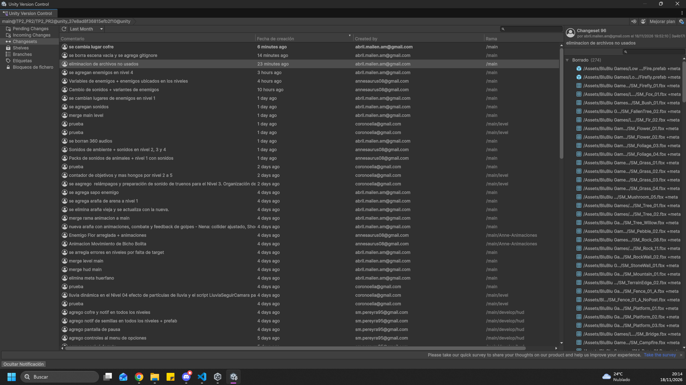

# Historial de cambios (Unity Version Control)

Historial completo de changesets del proyecto *El último sueño*, exportado del control de versiones de Unity.

- **Total:** 97 changesets (del #0 al #98; los ids 8 y 9 no existen en el repositorio)
- **Período:** 28/10/2026 al 18/11/2026

## Evidencia

Captura de la ventana **Unity Version Control > Changesets** del proyecto, tomada el 18/11/2026. Se ve la lista de changesets con comentario, fecha, autor y rama. A la derecha está abierto el **changeset 96** ("eliminacion de archivos no usados"), que registra 274 archivos borrados.

## Resumen

| Persona | Changesets |
|---|---:|
| abril.mailen.am | 34 |
| coronoelia | 32 |
| sm.pereyra95 | 18 |
| annesaurus08 | 13 |

| Rama | Changesets |
|---|---:|
| `/main` | 44 |
| `/main/level` | 30 |
| `/main/develop/hud` | 15 |
| `/main/Anne-Animaciones` | 6 |
| `/main/develop` | 1 |
| `/main/camara-fix` | 1 |

## Detalle por día

### 28/10/2026

- **#0** · 18:44 · abril.mailen.am · `/main` — (sin comentario)
- **#1** · 18:46 · abril.mailen.am · `/main` — Add packages and project settings to Unity Version Control.
- **#2** · 19:17 · abril.mailen.am · `/main` — primer commit

### 4/11/2026

- **#3** · 10:59 · annesaurus08 · `/main` — Modelo 3D Nena
- **#4** · 18:58 · abril.mailen.am · `/main` — paquete trees package
- **#5** · 19:55 · annesaurus08 · `/main` — Version del modelo 3D con color
- **#6** · 21:36 · abril.mailen.am · `/main` — Agrega movimiento, combate, tiempo de sueño y enemigo básico
  Jugadora con WASD y mouse, melee y semillas, DreamTimer con su UI y
  enemigo Bicharraco con NavMeshAgent. Incluye assets de bosque low poly.
- **#7** · 21:39 · abril.mailen.am · `/main` — (sin comentario)

### 6/11/2026

- **#10** · 20:15 · coronoelia · `/main/level` — Integración inicial del escenario Nivel 1
  Se incorpora el escenario Nivel 1 y los recursos del paquete Free Low Poly Nature Pack para realizar pruebas de integración.
- **#11** · 20:26 · coronoelia · `/main/level` — Ubicacion bicharraco

### 7/11/2026

- **#12** · 00:33 · coronoelia · `/main/level` — Menú principal - Estructura inicial
  Se crea la escena MenuPrincipal y se configura la estructura inicial de la interfaz: Canvas, Background, título del juego y botones Jugar, Créditos, Opciones y Salir. Se ajusta Canvas Scaler para una resolución de referencia de 1920x1080. Avance inicial de la integración del menú principal. y se agrega script LevelManager
- **#13** · 01:11 · coronoelia · `/main/level` — Pantalla de derrota y navegación funcional
  Se implementa la lógica de derrota del nivel mediante la suscripción al evento OnDreamEnded de DreamTimer. Al agotarse el tiempo, se muestra DefeatPanel y se pausa el juego.
  Se configura la funcionalidad de los botones:
  - REINTENTAR: restaura Time.timeScale y recarga Nivel_01.
  - VOLVER AL MENÚ: restaura Time.timeScale y carga MenuPrincipal.
  Se agrega EventSystem a Nivel_01 para habilitar la interacción con los botones de la interfaz y se incorporan las escenas necesarias al Build Profile.
- **#14** · 01:12 · coronoelia · `/main/level` — Configuración de Build Profiles y escenas
  Se registran los ajustes del perfil de Windows y la lista de escenas del proyecto.
- **#15** · 01:42 · coronoelia · `/main/level` — Créditos - Panel y navegación funcional
  Se crea CreditsPanel dentro de MenuPrincipal con título, información de integrantes del equipo y botón Volver.
  Se implementa MainMenuManager para gestionar la apertura y cierre del panel de créditos. Se conectan los botones CreditsBtn y BackBtn mediante sus eventos On Click().
  Se incorpora el comportamiento de hover reutilizable mediante ButtonHover en los botones de la interfaz.
- **#16** · 02:25 · coronoelia · `/main/level` — Menú principal - Navegación y opciones funcionales
  Se completa la lógica de navegación del menú principal mediante MainMenuManager.
  Se implementan las funcionalidades:
  - JUGAR: carga la escena Nivel_01.
  - CRÉDITOS: abre y cierra CreditsPanel.
  - OPCIONES: abre y cierra OptionsPanel.
  - VOLVER: permite regresar al menú principal desde los paneles.
  - SALIR: incorpora Application.Quit() para cerrar la aplicación en la versión ejecutable.
- **#17** · 15:19 · annesaurus08 · `/main` — subi enemigos insecto y flor, revisar el drive para ver como se moverian
- **#18** · 15:54 · coronoelia · `/main/level` — Nivel 01 - Incorporación de objeto coleccionable e interacción
  El objeto visual es provisional y podrá reemplazarse posteriormente por el cofre y la flor Con E agarra el hongo
- **#19** · 16:38 · coronoelia · `/main/level` — Sistema de recolección y actualización de objetivo
  Creación y configuración del script ObjetoColeccionable.cs.
  Ampliación de LevelManager para registrar la recolección.
  Actualización dinámica del texto del objetivo en el HUD.
  Prueba funcional de proximidad, recolección y actualización del objetivo.

### 8/11/2026

- **#20** · 15:30 · abril.mailen.am · `/main` — merge rama integracion 1
- **#21** · 17:56 · abril.mailen.am · `/main` — LevelExit.cs (archivo nuevo): la zona de salida del nivel.
  LevelManager.cs (de tu compañera, lo modifiqué):
  Agregué el panel de victoria y TryCompleteLevel(), que no deja ganar sin la flor.
  Agregué LoadNextLevel() y el campo Next Scene Name.
  Agregué el control _isFinished, para no ganar y perder a la vez.
- **#22** · 21:03 · abril.mailen.am · `/main/develop` — Agrega niveles 2 a 4 conectados y barrera de salida
  - Nivel_02, Nivel_03 y Nivel_04: copias del mapa, cada una con su salida
    en un cuadrante distinto y paredes invisibles que limitan la zona.
  - Los niveles se encadenan con LoadNextLevel (Nivel_01 a Nivel_04); el
    panel de victoria del último vuelve al menú principal.
  - LevelManager: campo Exit Barrier que bloquea la salida hasta recoger
    la flor.
  - Build Settings con las escenas en orden.

### 9/11/2026

- **#23** · 13:45 · coronoelia · `/main/level` — Panel menu principal descativo check
- **#24** · 13:58 · coronoelia · `/main/level` — panel opciones con funcion volumen correcto
- **#25** · 15:35 · coronoelia · `/main/level` — Ajustes de iluminación y ambientación de los niveles 2, 3 y 4.
- **#26** · 19:57 · abril.mailen.am · `/main` — merge main develop
- **#27** · 19:58 · abril.mailen.am · `/main` — merge main level
- **#28** · 20:19 · sm.pereyra95 · `/main/develop/hud` — Actualizo diseño portada mas botones
- **#29** · 22:43 · abril.mailen.am · `/main` — main merge hud
- **#30** · 23:33 · sm.pereyra95 · `/main/develop/hud` — merge

### 10/11/2026

- **#31** · 00:42 · coronoelia · `/main/level` — Incorporación del cofre Petal Chest y recursos asociados
- **#32** · 00:57 · coronoelia · `/main/level` — Restauración del cofre Petal Chest en Nivel_01 y actualización de recursos asociados.
- **#33** · 01:27 · coronoelia · `/main/level` — Se agregó un efecto visual de latido  y luz
- **#34** · 21:15 · sm.pereyra95 · `/main/develop/hud` — actualizo menú de opciones y agrego assets para el control de volumen
- **#35** · 23:22 · sm.pereyra95 · `/main/develop/hud` — actualizo panel objetivos en cada nivel

### 11/11/2026

- **#36** · 01:26 · sm.pereyra95 · `/main/develop/hud` — aplico retoques en panel objetivos
- **#37** · 19:29 · abril.mailen.am · `/main` — merge main level
- **#38** · 19:30 · abril.mailen.am · `/main` — merge main hud
- **#39** · 19:37 · sm.pereyra95 · `/main/develop/hud` — merge
- **#40** · 20:54 · sm.pereyra95 · `/main/develop/hud` — Actualizo diseño del timer
- **#41** · 21:00 · abril.mailen.am · `/main` — merge main hud
- **#42** · 21:08 · annesaurus08 · `/main/Anne-Animaciones` — Animaciones de movimiento de personaje, lo guarde en el prefab de la nena
  Y mergee la maina mi rama
- **#43** · 21:27 · sm.pereyra95 · `/main/develop/hud` — merge

### 12/11/2026

- **#44** · 01:19 · sm.pereyra95 · `/main/camara-fix` — Arreglo angulo de la camara
- **#45** · 01:23 · sm.pereyra95 · `/main` — merge main camara fix
- **#46** · 10:31 · annesaurus08 · `/main/Anne-Animaciones` — Anim de la nena en movimiento y golpe melee + codigo para conectarlos
- **#47** · 10:34 · annesaurus08 · `/main/Anne-Animaciones` — Nena Controller
- **#48** · 16:26 · coronoelia · `/main/level` — Integro cambios de la rama develop/hud
- **#49** · 17:33 · coronoelia · `/main/level` — notificaciones de recompensas del cofre
  Al abrirlo, el cofre entrega aleatoriamente una de las dos recompensas disponibles: +15 segundos de tiempo de sueño o +5 semillas. La notificación muestra el beneficio correspondiente durante 2,5 segundos y luego desaparece automáticamente.
  Se vinculó el sistema de notificaciones con el script PetalChest.cs y se realizaron pruebas de interacción, verificando que el mensaje coincida con la recompensa obtenida y que el panel se muestre correctamente.
- **#50** · 20:50 · coronoelia · `/main/level` — Implementación de sonido ambiental en el menú principal.
- **#51** · 22:18 · coronoelia · `/main/level` — nuevo modelo 3D de semilla bala
   visualmente las semillas disparadas por el personaje.
- **#52** · 23:48 · coronoelia · `/main/level` — se corrige araña deja de flotar

### 13/11/2026

- **#53** · 01:19 · coronoelia · `/main/level` — semillas sobre los enemigos sin resolver
- **#54** · 02:06 · coronoelia · `/main/level` — sonido para el disparo de semillas
- **#55** · 02:06 · coronoelia · `/main/level` — sonido
- **#56** · 18:07 · sm.pereyra95 · `/main` — merge main level
- **#57** · 18:12 · sm.pereyra95 · `/main/develop/hud` — merge
- **#58** · 18:23 · annesaurus08 · `/main/Anne-Animaciones` — Prefab+movimiento Araña
- **#59** · 18:44 · coronoelia · `/main/level` — objetivos visuales y contador de semillas en los cuatro niveles
- **#60** · 20:11 · abril.mailen.am · `/main` — merge main level
- **#61** · 21:15 · abril.mailen.am · `/main` — merge de rama animacion y se arregla hundimiento de nena en el terreno
- **#62** · 21:44 · sm.pereyra95 · `/main/develop/hud` — agrego ui panel victoria

### 14/11/2026

- **#63** · 00:10 · sm.pereyra95 · `/main/develop/hud` — agrego panel ui derrota
- **#64** · 02:27 · sm.pereyra95 · `/main/develop/hud` — agrego controles al menu de opciones
- **#65** · 09:53 · sm.pereyra95 · `/main/develop/hud` — agrego pantalla de pausa
- **#66** · 10:43 · sm.pereyra95 · `/main/develop/hud` — agrego notif de semillas en todos los niveles + prefab
- **#67** · 12:43 · sm.pereyra95 · `/main/develop/hud` — agrego cofre y notif en todos los niveles
- **#68** · 13:22 · coronoelia · `/main/level` — prueba
- **#69** · 14:09 · coronoelia · `/main/level` — lluvia dinámica en el Nivel 04
  efecto de partículas de lluvia y el script LluviaSeguirCamara para mantener la lluvia acompañando el movimiento de la cámara durante todo el recorrido del nivel.
- **#70** · 14:20 · coronoelia · `/main` — prueba
- **#71** · 14:42 · abril.mailen.am · `/main` — elimina meta huerfano
- **#72** · 14:47 · abril.mailen.am · `/main` — merge hud main
- **#73** · 15:11 · abril.mailen.am · `/main` — merge level main
- **#74** · 15:24 · abril.mailen.am · `/main` — se arregla errores en niveles por falta de target
- **#75** · 16:22 · annesaurus08 · `/main/Anne-Animaciones` — Animacion Movimiento de Bicho Bolita
- **#76** · 17:06 · annesaurus08 · `/main/Anne-Animaciones` — Enemigo Flor arreglada + animaciones
- **#77** · 17:39 · abril.mailen.am · `/main` — nueva araña con animaciones, combate y feedback de golpes
  - Nena: collider ajustado, ShootPoint bajado y referencias reasignadas
    (Dream Timer UI, LevelManager, CameraController, SeedCounterUI, SeedPool).
  - Nueva araña (Spiders pack): materiales convertidos a URP, prefab Spider
    y controller SpiderEnemy con Idle, Walk, Attack1/2, Hit y Death.
  - Enemy: animaciones por Animator, giro corregido del modelo, ataque
    aleatorio, feedback de golpe (parpadeo y sonido), muerte con hundimiento.
  - DreamTimer: evento OnDamaged; nuevo PlayerHitFeedback para el golpe a la Nena.
  - Semilla: collider corregido para que impacte a los enemigos.
  - Se agregan carpetas Animations, Spiders y Audio;
- **#78** · 18:14 · abril.mailen.am · `/main` — merge rama animacion a main
- **#79** · 18:52 · abril.mailen.am · `/main` — se elimina araña vieja y se actualiza con la nueva.
- **#80** · 18:55 · abril.mailen.am · `/main` — se agrega araña de arena a nivel 1
- **#81** · 20:32 · abril.mailen.am · `/main` — se agrega sapo enemigo

### 16/11/2026

- **#82** · 13:59 · coronoelia · `/main/level` — se aagrego  relámpagos y preparación de sonido de truenos para el Nivel 3. Organización de scripts en carpetas según responsabilidades: Player, Enemies, Combat, Items, Systems, Managers, Level, Camera, Environment, UI y Core.
- **#83** · 15:37 · coronoelia · `/main/level` — contador de objetivos y mas hongos por nivel 2 a 5
- **#84** · 15:41 · coronoelia · `/main` — prueba

### 17/11/2026

- **#85** · 09:22 · annesaurus08 · `/main` — Packs de sonidos de animales + nivel 1 con sonidos
- **#86** · 10:08 · annesaurus08 · `/main` — Sonidos de ambiente + sonidos en nivel 2, 3 y 4

### 18/11/2026

- **#87** · 00:30 · abril.mailen.am · `/main` — se borran 360 audios
- **#88** · 00:34 · coronoelia · `/main/level` — prueba
- **#89** · 00:40 · coronoelia · `/main/level` — prueba
- **#90** · 00:42 · abril.mailen.am · `/main` — merge main level
- **#91** · 01:04 · abril.mailen.am · `/main` — se agregan sonidos
- **#92** · 01:22 · abril.mailen.am · `/main` — se cambian lugares de enemigos en nivel 1
- **#93** · 09:55 · annesaurus08 · `/main` — Cambio de sonidos + variantes de enemigos
- **#94** · 15:46 · annesaurus08 · `/main` — Variables de enemigos + enemigos ubicados en los niveles
- **#95** · 17:07 · abril.mailen.am · `/main` — se agregan enemigos en nivel 4
- **#96** · 19:52 · abril.mailen.am · `/main` — eliminacion de archivos no usados
- **#97** · 20:00 · abril.mailen.am · `/main` — se borra escena vacia y se agrega gitignore
- **#98** · 20:08 · abril.mailen.am · `/main` — se cambia lugar cofre
